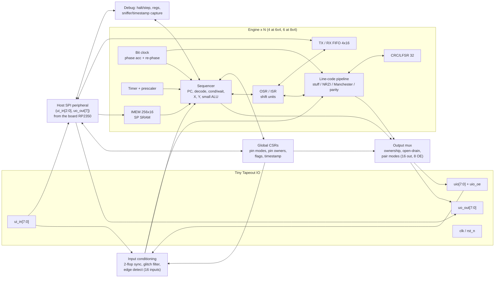

# Architecture (preliminary)

> **Status: Draft — open for discussion.** Nothing in this document is
> final. Engine count, ISA, memory sizes, pin map and area figures are
> proposals and estimates, to be validated by the first synthesis and
> place-and-route runs. Comments and alternative proposals are welcome.

Written 2026-10-11. Numbers marked **(estimate)** or **(hypothesis)** are not
yet backed by synthesis, place-and-route or silicon. Inputs:
[protocol-comparison.md](protocol-comparison.md) (requirement matrix) and the
per-protocol notes in [protocols/](protocols/README.md). SRAM integration
details: [ihp-sram-notes.md](ihp-sram-notes.md).

## 1. Overview

| Item | Current plan |
|---|---|
| Configurations | One parameterized RTL (`NUM_ENGINES`, `IMEM_DEPTH`, `DATA_SRAM`): **6x4 baseline** = 4 engines; **8x4 upgrade** = 6 engines + one shared 512×32 packet SRAM (section 6) |
| Engines | Identical protocol engines in a single clock domain. Not a general CPU: a sequencer for pin and timing primitives |
| ISA | **16-bit** fixed-width instructions, 8 classes, 1 instruction per cycle, data-independent timing, tick-gate bit for rate-independent bit timing |
| Instruction memory | **256 × 16 bits per engine**, one IHP single-port SRAM macro each (`RM_IHPSG13_1P_256x16_c2_bm_bist`, 236.80 × 118.78 µm). Fallbacks: 64×16 macro, then latch array |
| Per-engine datapath | 2 × 16-bit registers (X, Y), 32-bit OSR/ISR, fractional bit clock with re-phase (DPLL), 16-bit timer with prescaler, line-code pipeline (stuff/NRZI/Manchester/parity), 32-bit programmable CRC, 4 × 16 TX and RX FIFOs |
| Host | The **RP2350** on the Tiny Tapeout ETR demo board, through a hard-wired SPI peripheral on 4 TT pins (program load, CSR access, FIFOs, debug). Programs are reloaded every time the design is selected (section 12) |
| Software | Assembler + disassembler, cycle-accurate reference model, host library (MicroPython on the RP2350, plus desktop Python), an example program per protocol (section 14) |
| Pins for protocols | 5 inputs + 6 outputs + 8 bidirectional (19 of 24), all 24 if the host link is released; 3.3 V IO; external parts on Pmods |
| Clock | Design goal: close timing at **50 MHz** at the slow corner; run 50 MHz generally and exactly 40 MHz for 10BASE-T TX (section 11) **(hypothesis)** |
| Area | 6x4: ≈ 490 k µm², ≈ 53 % of an estimated 0.92 mm² die. 8x4: ≈ 820 k µm², ≈ 67 % of 1.225 mm² **(estimates)** |

## 2. Assumptions

| # | Assumption | Status |
|---|---|---|
| A1 | TT IO: 8 `ui_in`, 8 `uo_out`, 8 `uio` with active-high `uio_oe`, plus `clk`, `rst_n`, `ena`; 3.3 V digital IO; no analog pads | Verified ([TT GPIO spec](https://tinytapeout.com/specs/gpio/), [IHP template](https://github.com/TinyTapeout/ttihp-verilog-template)) |
| A2 | Die area: 6x4 ≈ 0.92 mm², 8x4 ≈ 1.225 mm² | 8x4 die 1724.16 × 710.64 µm from a public hardened CMOS5L design ([ihp-sram-notes.md](ihp-sram-notes.md)); 6x4 **estimated** from Jane Street's "8x4 ≈ 30 % more". The nominal 0.7 mm² (24 tiles × 200 × 150 µm) is kept as the conservative case. To confirm by hardening an empty 6x4 design |
| A3 | CMOS5L metal stack Metal1–Metal4 + TopMetal1; tiles route on Metal2–Metal4 only (TopMetal belongs to the harness); tile power is vertical Metal4 stripes only | Verified (TT mux config `cfg/ihp-sg13cmos5l.yaml`; SRAM walkthrough) |
| A4 | Several IHP SRAM macros are usable on CMOS5L | A public CMOS5L design hardens clean with two 512×32 macros; the CMOS5L SRAM library is the SG13G2 one (symlink). Risk: 4–6 macros on the Metal4 power rhythm |
| A5 | 256x16 SP SRAM = 236.80 × 118.78 µm (28 127 µm²) | Verified from the PDK LEF |
| A6 | Logic Fmax ≥ 50 MHz at slow corner after P&R | **Hypothesis**; first flow run |
| A7 | IO pad speed/drive on the CMOS5L TT chip | **Unknown**: no CMOS5L pad characterization published; TT's published limits are for sky130 |
| A8 | Clock from the ETR board's RP2350 by PWM from its system clock | Verified by reading the [TT MicroPython SDK](https://github.com/TinyTapeout/tt-micropython-firmware) (`clock_project_PWM`): it picks a system clock that an even divider maps exactly onto the request (40 MHz = 80 MHz / 2, 50 MHz = 100 MHz / 2). Board crystal ppm **not verified** |
| A9 | IHP cell areas: DFF with reset (`sg13cmos5l_dfrbpq_1`) 49.0 µm²; NAND2 7.3; MUX2 18.1; XOR2 14.5; latch (`dlhq_1`) 30.8 µm² | Verified in the CMOS5L stdcell LEF |
| A10 | Placement density 60 % (template `PL_TARGET_DENSITY_PCT`) | Template default |

## 3. Method: from protocols to primitives

1. For each protocol, list the operations that must happen at line rate (per
   bit or per edge) versus per byte/packet (firmware or host).
2. Group line-rate operations into primitives that appear in **two or more**
   protocols. A primitive used by only one protocol is a fixed-function block
   in disguise and is rejected, unless it is generic in form (e.g. a CRC unit
   with programmable polynomial serves five protocols).
3. Give each primitive **configuration** (CSR fields set once per protocol)
   and **control** (instruction-level operations). Configuration chooses the
   protocol; instructions run it. A new protocol should need new firmware and
   CSR values only, never RTL.
4. Check every protocol against the primitive set: if one needs more than
   "configure + a few instructions per bit" at the target rate, either the
   primitive set grows or the protocol drops a tier.

| Protocol | Per-edge / per-bit work at line rate | Per byte / packet (firmware or host) |
|---|---|---|
| UART | Bit tick, shift 1 bit, start-edge resync, mid-bit sample | Parity, framing check, FIFO push |
| SPI | Toggle SCLK with data change, shift in/out, sample delay | Command sequencing, CS |
| I2C | Open-drain drive, wait SCL high (stretch), sample SDA, mismatch check | Address match, ACK decision, START/STOP sequencing |
| JTAG | Set TMS+TDI with TCK edge, sample TDO | TAP state walk, IR/DR lengths |
| SWD | Shift with SWCLK, OE turnaround, parity | ACK handling, retries, DP/AP sequencing |
| PS/2 | Wait CLK edge, sample/drive open-drain DATA | Parity, scan-code handling, timeouts |
| CAN | tq timing, sample point, resync ±SJW, stuff/destuff, CRC-15, TX/RX compare | Filtering, error counters, frame assembly |
| USB LS | DPLL, NRZI, stuff/destuff, CRC5/16, J/K/SE0, EOP detect | PID decode, response selection, enumeration (host) |
| 10BASE-T TX | Manchester half-bits every 2 cycles at 40 MHz, CRC-32 | Frame/IP/UDP building (host) |

## 4. Primitives

Costs are first-order **estimates** per engine unless noted.

| # | Primitive | What it does | Used by | Cost (estimate) |
|---|---|---|---|---|
| P1 | Pin groups with per-pin mode | Engines address pins through base+count windows (IN, OUT, SIDE) over the 24 TT IO (16 readable: `ui_in` + `uio_in`; 16 drivable: `uo_out` + `uio_out`; 8 OE). Per-pin mode: push-pull, input, **open-drain** (drive 0 = OE on with 0; drive 1 = OE off), **pair** (pin n+1 = NOT pin n, plus "both low" for USB SE0 / Ethernet idle, and "both released"). Hardware modes, so firmware cannot drive a 1 onto an I2C line and a pair cannot enter SE1 | All; open-drain: I2C, PS/2, SWD reset, SMBus; pair: USB LS, 10BASE-T | ≈ 300–500 cells shared |
| P2 | Pin ownership | A 3-bit owner field per pin; only the owning engine's OUT/OE reaches the pad. All engines may **read** all pins (sniffing, loopback). Exclusivity is checked in hardware and proved formally | Multi-protocol operation, sniffer mode | ≈ 72 flops + muxes, shared |
| P3 | Input conditioning | 2-flop synchronizer on every input, optional 2–3-sample glitch filter per pin group, rising/falling edge pulses | All receivers; filter for I2C (50 ns tSP), PS/2 | ≈ 50 flops shared |
| P4 | Bit clock with re-phase (DPLL) | 16-bit phase accumulator with programmable increment gives bit (or tq) ticks at any rate, ≤ 1-cycle jitter, < 0.01 % rate error. **Hard sync** (set phase: UART start bit, CAN SOF) or **bounded resync** (move toward the edge by at most a limit: CAN SJW, USB/Ethernet DPLL). The engine itself runs at full clock | UART, CAN, USB LS, 10BASE-T RX; clock generator for SPI/I2C/JTAG/SWD/PS/2 | ≈ 120 cells |
| P5 | Wait / condition unit | Stall until a condition: pin level or edge, two-pin condition (edge on A while B high: I2C START/STOP), bit tick, timer, FIFO state, flag, mismatch. Every wait can carry a **timeout**, so error paths are cycle-bounded | All | ≈ 60 cells |
| P6 | Timers | 16-bit down counter with prescaler (÷1, ÷16, ÷256, ÷4096) for 2–150 ms windows; one global free-running 24-bit timestamp | SMBus, PS/2, USB suspend/reset, Ethernet NLP, CAN bus-off, timestamps | ≈ 40 flops + 24 shared |
| P7 | Shift units (OSR/ISR) | 32-bit output and input shift registers; 1–16 bits per instruction; LSB/MSB first; 1, 2 or 4 bits per step; autopull/autopush at a threshold. Feed the line-code pipeline | All | ≈ 250 cells |
| P8 | Side-set | 2-bit field driving 1–2 pins (or their OE) in the same cycle as the main operation | SPI/JTAG/SWD clocks, SWD turnaround, CS | Small |
| P9 | Line-code pipeline | TX: shift → CRC tap → **bit stuffer** (opposite bit after N equal bits or N ones, N = 4–7) → **encoder** (NRZ / NRZI / Manchester / none) → pin or pair. RX: pin → decoder → destuffer (flags stuff errors) → CRC tap → shift. Running parity | USB LS, CAN, 10BASE-T, Manchester IR/RF, parity for UART/PS/2/SWD | ≈ 40 flops + 100 cells |
| P10 | CRC / LFSR | Serial CRC, programmable width (≤ 32), polynomial, init, reflection, final XOR; tracks **destuffed** data; result appendable to TX; "CRC residue OK" as condition; also an LFSR for PRBS | USB (CRC5/16), CAN (CRC-15), Ethernet (CRC-32), SMBus (CRC-8), SD (CRC-7/16) | ≈ 135 cells |
| P11 | Mismatch detector | Compares driven (or released) value with the synchronized pin at a chosen moment; sticky flag usable as condition and IRQ | I2C arbitration/stretching, CAN arbitration/bit error, PS/2 inhibit, contention | Few cells |
| P12 | FIFOs | Per engine TX and RX FIFOs (4 × 16 bits) to the host link; status as wait conditions | All streaming | ≈ 200 cells; depth is a knob |
| P13 | Flags / IRQs | 8 shared flags; set/clear/wait; maskable host IRQ pin | Cooperating engines, synchronized start | Small |
| P14 | Timestamped capture (sniffer) | Push (timestamp, pin state) records into the RX FIFO on changes of a pin group: logic analyzer / protocol sniffer on the same datapath | Debug, reverse engineering, on-silicon self-check | Reuses P6 + P12 |

### Coverage check

| Primitive | UART | SPI | I2C | JTAG | SWD | PS/2 | CAN | USB LS | 10BT TX |
|---|---|---|---|---|---|---|---|---|---|
| P1 pin modes | ● | ● | ● OD | ● | ● | ● OD | ● | ● pair | ● pair |
| P2 ownership | ● | ● | ● | ● | ● | ● | ● | ● | ● |
| P3 input cond. | ● | ● | ● filt | ● | ● | ● filt | ● | ● | |
| P4 bit clock / DPLL | ● hard | ● gen | ● gen | ● gen | ● gen | ● gen | ● ±SJW | ● every edge | ● gen |
| P5 wait + timeout | ● | ● | ● | ● | ● | ● | ● | ● | ● |
| P6 timers | ○ | | ● SMBus | | ○ | ● | ● | ● | ● NLP |
| P7 shift units | ● | ● | ● | ● ×2 | ● | ● | ● | ● | ● |
| P8 side-set | | ● | ○ | ● | ● OE | | | | |
| P9 line code | ○ par | | | | ○ par | ○ par | ● stuff5 | ● NRZI+stuff6 | ● Manchester |
| P10 CRC | | ○ SD | ○ PEC | | | | ● CRC15 | ● CRC5/16 | ● CRC32 |
| P11 mismatch | | | ● | | | ● | ● | | |
| P12 FIFOs | ● | ● | ● | ● | ● | ● | ● | ● | ● |

● required, ○ useful. No primitive is used by only one protocol.

## 5. Block diagram



## 6. Engine

Each engine is a small sequencer that issues one 16-bit instruction per
cycle from its own SRAM and sequences the primitives P1–P14.

**Fetch without bubbles (hypothesis).** The SRAM is synchronous (address
registered at the clock edge, read data valid after it). The next-PC logic is
combinational from the current instruction (the SRAM output), the condition
inputs and the stall signal, and drives the SRAM address directly. The
instruction at the new PC is on the SRAM output in the next cycle: one
instruction per cycle, taken branches free, a stall re-reads the same
address. Critical path: SRAM clock-to-out → decode → condition mux → next-PC
mux → SRAM address setup, which must fit 20 ns. If it does not, the fallback
is a 2-stage pipeline with a fixed 1-cycle branch penalty (still
deterministic; the assembler accounts for it).

**State per engine (estimate).**

| Block | Flops | Comb cells | Notes |
|---|---|---|---|
| PC + 1-level return | 16 | 120 | `call`/`ret` for shared bit routines |
| X, Y (16-bit) + ALU (add/sub/and/or/xor/cmp/dec) | 32 | 200 | |
| OSR, ISR (32-bit) + counters | 76 | 120 | autopull/autopush thresholds |
| Bit clock (16-bit phase + 16-bit increment) + re-phase | 32 | 110 | hard sync, bounded resync |
| Timer (16-bit + prescaler + reload) | 44 | 50 | waits with timeout |
| Line-code pipeline | 13 | 80 | stuff rule N=4..7, NRZ/NRZI/Manchester, parity |
| CRC/LFSR (state 32 + poly 32 + cfg) | 70 | 70 | width ≤ 32, reflect, init, xorout |
| FIFOs TX/RX 4 × 16 | 134 | 100 | |
| Pin windows (IN/OUT/SIDE bases, counts, jmp pin) | 21 | 200 | select 8-of-16 inputs, place outputs |
| Decode, wait/condition, control | 16 | 150 | |
| Enable/mux overhead on flops | — | 300 | ~0.7 per flop |
| **Engine total** | **≈ 454** | **≈ 1 500** | **≈ 39 k µm²** at A9 cell areas |

### Configurations: 6x4 baseline, 8x4 upgrade

The target is 6x4 tiles. Jane Street has mentioned a possible 8x4 upgrade,
so the RTL is parameterized and the pin-owner width and host address map are
sized for it from the start: moving to 8x4 is a re-harden with different
parameters, not a redesign.

| Parameter | 6x4 baseline | 8x4 upgrade | Notes |
|---|---|---|---|
| `NUM_ENGINES` | 4 | 6 | Extra engines serve as sniffers, split TX/RX, or cooperating engines (USB bit layer + responder) |
| `IMEM_DEPTH` | 256 | 256 (512 optional) | 512×16 macro is 236.80 × 191.34 µm |
| `DATA_SRAM` | none | one shared 512×32 (2 KB) | Packet buffer for USB LS / Ethernet frames, arbitrated between engines and host; not cycle-deterministic, so used only outside timed sections |
| Pin owner field | 3 bits (up to 8 engines) | same | Fixed now so the CSR map does not change |
| Area (estimate) | ≈ 490 k µm² | ≈ 820 k µm² | Section 15 |

`NUM_ENGINES=2` is kept as an emergency configuration (much lower density
than expected, or routing failure around the SRAMs). An alternative 8x4
configuration keeps 4 engines with 512-word memories plus the data SRAM
(≈ 660 k µm²): more engines favour concurrency, bigger memories favour
larger programs. To be compared once 8x4 is available.

## 7. ISA sketch (not final)

16-bit instructions, one SRAM word each. Common fields:

```text
 15 14 13 | 12 | 11 10 | 9 ........................ 0
  class   |  T | side  | operand (class-specific)
```

- **class** (3 bits): one of 8 classes below.
- **T** (tick gate): stall until the next bit-clock tick, then execute in the
  tick cycle. Bit timing comes from the bit clock rather than from delay
  counts, so the same program runs at any rate set by one CSR.
- **side** (2 bits): drive up to 2 side-set pins or their OE (per CSR) in the
  same cycle. Not available on `jmp` (the field holds the condition).
- Every instruction takes 1 cycle unless it waits, so cycle counts can be
  checked statically by the assembler and formally in RTL.

| Class | Mnemonics | Operand layout (bits 9..0, or 11..0 for jmp) |
|---|---|---|
| 000 WAIT | `wait [!]cond [tmo]` | pol 1, timeout-enable 1, source 5 (pin level, pin edge rise/fall, START/STOP combo, tick, timer, FIFO, flag, mismatch), index 3 |
| 001 JMP | `jmp cond, addr` / `call` | cond 4 (always, !x, x--, !y, y--, x!=y, pin, !pin, mismatch, crc_ok, osr_empty, rx_full, flag, timeout, call, ret) in bits 11..8, addr 8 |
| 010 SHIFT | `out dst, n` / `in src, n` | dir 1, dst/src 3 (pins, pindirs, X, Y, null, pipeline-raw, CRC), count 4 (1–16), flags 2 (e.g. last-bit TMS for JTAG) |
| 011 SET | `set dst, imm` | dst 2 (pins, pindirs, X, Y), imm 8 |
| 100 ALU/MOV | `mov`, `add`, `sub`, `and`, `or`, `xor`, `rev`, `cmp` | op 3, dst 3, src 3, 1 spare |
| 101 TIME | `sync hard/soft`, `tmr load/start`, `nop` | op 2, arg 8 (phase value, timer register or prescaler) |
| 110 FIFO/FLAG | `push`, `pull`, `irq set/clr`, `hostirq` | op 2, block 1, index/flags 7 |
| 111 SYS | `csrw`, `csrr`, `halt`, `brk` | op 2, CSR address 6, 2 spare |

Constants wider than 8 bits come from CSRs or the host FIFO. Firmware can
change encoder/CRC settings mid-stream with `csrw` (e.g. USB: NRZI for
SYNC/PID, then enable CRC16 for the data stage). Illustrative programs
(syntax not final):

```text
; UART TX 8N1. Bit clock = baud (one CSR). OSR LSB-first, pull 8 bits.
tx:    wait  tx_nonempty
       pull
       set   pins, 0        @tick     ; start bit
       set   x, 7
txbit: out   pins, 1        @tick     ; data bits
       jmp   x--, txbit
       set   pins, 1        @tick     ; stop bit (lasts until next start @tick)
       jmp   tx

; UART RX 8N1 with start-bit glitch reject and framing check.
rx:    wait  fall pin0
       sync  hard, half               ; next tick lands mid start bit
       nop                  @tick
       jmp   pin, rx                  ; line went high again: glitch
       set   x, 7
rxbit: in    pins, 1        @tick
       jmp   x--, rxbit
       jmp   !pin, ferr     @tick     ; stop bit must be 1
       push
       jmp   rx
```

```text
; I2C controller, write one bit. SCL on side-set, both pins open-drain mode.
wbit:  out   pins, 1        side 0b00 @tick   ; SDA set while SCL low
       nop                  side 0b01 @tick   ; release SCL
       wait  high scl  tmo                     ; clock stretching, bounded
       jmp   mismatch, lost                    ; SDA released but read 0: arbitration lost
```

The UART programs contain no cycle counts; the I2C program's timing is set by
the tick rate (2 ticks per SCL period).

## 8. Memories

| Memory | Size | Implementation | Area (estimate) |
|---|---|---|---|
| IMEM per engine | 256 × 16 | `RM_IHPSG13_1P_256x16_c2_bm_bist`, 236.80 × 118.78 µm | 28.1 k µm² each; 35.6 k with a 10 µm keep-out |
| Fallback 1 | 64 × 16 per engine | `RM_IHPSG13_1P_64x16_c2` (no mask/BIST), 236.80 × 64.36 µm | 15.2 k µm² each |
| Fallback 2 | 64 × 16 per engine | latch array | ≈ 36 k µm² each |
| Same 256 × 16 in flops (not planned) | 4096 bits | DFF + read mux ≈ 59 µm²/bit | ≈ 242 k µm² each |
| Data/packet SRAM (8x4 only) | 512 × 32 | `RM_IHPSG13_1P_512x32_c2_bm_bist`, 416.64 × 191.34 µm | 79.7 k µm² |
| FIFOs | 2 × 4 × 16 per engine | flops | in engine logic |

SRAM interface rules (PDK datasheet): tie `A_DLY` = 1 and all `A_BIST_*` = 0;
`A_MEN` must be high for any access; inputs sampled on the rising `A_CLK`;
read data registered. The host writes a halted engine's IMEM through the same
port (mux on address, data, write enable). SRAM contents are lost when the
design is deselected (section 12).

**Floorplan (hypothesis).** CMOS5L tiles have only vertical Metal4 power
stripes, and a macro is powered only where a stripe lands on its Metal4
supply columns. The 256×16 and 64×16 macros share the 512×32's column rhythm
(VDD at 4.26 + 11.24·k µm, VSS at 9.88 + 11.24·k µm), so placing each macro at
x = 3.36 + 44.96·n with the grid in [ihp-sram-notes.md](ihp-sram-notes.md)
should feed them. Stack the four 6x4 IMEMs in one column at the left edge in
two face-to-face pairs (4 × 118.78 = 475 µm of the ≈ 710 µm die height plus
gaps), with each engine's logic beside its macro's pin face.

## 9. Host interface and program load

**Software-toggle model.** A protocol ships as a **pack**: program image for
one engine (≤ 256 × 16-bit words), a CSR block (pin group bases and modes,
bit-clock increment, line-code and CRC configuration, FIFO thresholds) and a
pin request (which pins, which modes). The assembler produces packs from
source plus a small manifest; the host library loads them.

- **Host:** the **RP2350** on the TT ETR demo board
  ([PCB-ETR page](https://tinytapeout.com/specs/pcb-etr/)). Per the TT
  MicroPython SDK GPIO map, RP2350 GPIO 17–24 drive `ui_in[0..7]`, GPIO 33–40
  read `uo_out[0..7]`, GPIO 25–32 connect to `uio[0..7]`, GPIO 16 is the
  project clock and GPIO 14 the project reset. The RP2350 can act as SPI
  controller on the host-link pins directly. Whether the board's DIP switches
  on `ui_in` must be off is **to verify**.
- **Physical:** SPI mode 0 peripheral, sampled by the core clock (single
  clock domain; host SCK ≤ core/4, ≤ 12.5 MHz at 50 MHz, **hypothesis**).
- **Frame:** `cmd[8] addr[16] data[16]...` with auto-increment. Commands:
  write, read, engine control (start/halt/step/reset by engine mask, so
  several engines start in the same cycle), FIFO push/pop, status, and a
  **chip ID/version + "configured" flag** read.
- **Address map (draft):**

| Range | Contents |
|---|---|
| `0x0000–0x07FF` | IMEM of up to 8 engines (256 words each; writable only while the engine is halted) |
| `0x8000–0x80FF` | Global CSRs (pin modes, owners, flags, timestamp, host-link release) |
| `0x9000–0x97FF` | Per-engine CSRs (pin windows, bit clock, timer, line code, CRC, FIFO thresholds) |
| `0xA000` | FIFO ports |
| `0xB000` | Debug (PC, X, Y, OSR, ISR, status, breakpoints) |
| `0xC000` | Data SRAM window (8x4 only) |

- **Load time:** 4 × 256 words ≈ 16 kbit + overhead ≈ 2 ms at 10 MHz
  **(estimate)**, paid after every reset and every re-selection.
- **Later options:** UART host link, or autonomous boot from an external SPI
  flash (TT QSPI Pmod).

**Runtime switching.** Switching protocols on an engine = halt it, release
its pins (Hi-Z), rewrite its program and CSRs, reassign pins, restart. Other
engines keep running. A pin changes owner only while released; ownership
writes to a pin owned by a running engine are rejected and flagged.

**Sharing pins.** Reads are free for every engine (sniffing, internal
loopback for self-test); writes go only through ownership. Engines cooperate
through flags (P13): e.g. one engine runs a USB bit-level receiver while
another prepares the response, or two engines run TX and RX of a UART.

**Example configuration** (all at once):

| Engine | Pack | Pins |
|---|---|---|
| E0 | UART 115200 to the board MCU's USB serial | `ui_in[3]` RX, `uo_out[4]` TX |
| E1 | SPI controller to a flash | `uio[0..3]` |
| E2 | I2C controller | `uio[6]` SCL, `uio[7]` SDA (open-drain) |
| E3 | Sniffer on E1 + E2 pins with timestamps | read-only |

## 10. Pin map (draft)

| TT pin | Use | Notes |
|---|---|---|
| `clk` | Core clock | From the RP2350 (GPIO 16) |
| `rst_n` | Reset (async assert, synchronized deassert) | From the RP2350 (GPIO 14); section 12 |
| `ena` | Ignored | Always 1 when the design is powered |
| `ui_in[0]` | HOST_SCK | Releasable to engines after configuration |
| `ui_in[1]` | HOST_CS_N | Releasable |
| `ui_in[2]` | HOST_MOSI | Releasable |
| `ui_in[7:3]` | Engine inputs | `ui_in[3]` = UART RX from the board MCU (TT convention) |
| `uo_out[7]` | HOST_MISO | Releasable |
| `uo_out[6:0]` | Engine outputs | `uo_out[4]` = UART TX to the board MCU (TT convention); `uo_out[6]` optional HOST_IRQ |
| `uio[7:0]` | Engine bidirectional, open-drain or pair | TT Pmod conventions: SPI `uio[0..3]` = CS, MOSI, MISO, SCK; UART `uio[0..3]` = (CTS), TXD, RXD, (RTS); I2C `uio[2]`/`uio[3]` = SCL/SDA (bottom row `uio[6]`/`uio[7]`); QSPI `uio[0..7]` = CS0, SD0, SD1, SCK, SD2, SD3, CS1, CS2 |

Pin conventions: [TT pinouts](https://tinytapeout.com/specs/pinouts/). All IO
is 3.3 V digital. Anything beyond a 3.3 V pin (pull-ups, transceivers, level
shifters, magnetics) goes on a Pmod, documented with the example program (see
each protocol note). `uo_out` cannot be tri-stated, so its reset value (0) is
visible; UART TX idles at 0 until configured.

## 11. Clocking

Single clock domain driven by `clk`; no internal clock generation and no
gated clocks (simpler CTS and STA). Every external input, including the host
SPI pins, goes through a 2-flop synchronizer. Bit timing comes from
per-engine phase accumulators, not from derived clocks.

**Clock choice.** The ETR SDK's `clock_project_PWM()` sets the RP2350 system
clock so that an even PWM divider gives the requested frequency exactly
(40 MHz from 80 MHz ÷ 2, 50 MHz from 100 MHz ÷ 2, 48 MHz from 96 MHz ÷ 2),
50 % duty; accuracy is that of the board crystal (**ppm not verified**;
10BASE-T needs ≤ 100 ppm). "Close timing at 50 MHz, run at 40 MHz for
Ethernet" therefore needs no on-chip support. An on-die PLL is not planned.

## 12. Reset, power-down and reload

- **Flops do not power up at a known value.** Every control flop (PC,
  run/halt, stall, FIFO pointers, pin modes, owners, `uio_oe`, host-link
  state) is reset by `rst_n` (asynchronous assert, synchronized deassert).
  Datapath registers (X, Y, shift registers, CRC state, FIFO contents) may
  stay unreset to save area **only if** a formal property shows no pin can be
  driven from them before the engine is configured and started.
- **After reset:** all engines halted, all `uio_oe` = 0 (Hi-Z), `uo_out` = 0,
  host link active, "configured" flag = 0, SRAM content undefined.
- **Deselect = power-down.** A Tiny Tapeout design loses all state, SRAM
  included, when it is deselected on the mux. The host library treats every
  select as a cold start: select → assert `rst_n` → release → read chip ID
  and "configured" flag (0) → load all packs → start. The flag lets the host
  detect an unexpected loss of state.
- **Verification:** simulate with random initial values for all flops (e.g.
  Verilator `--x-initial unique` with random seeds) and prove the post-reset
  safe state formally from an arbitrary initial state.

## 13. Debug and observability

- Host can halt, single-step and resume each engine; read PC, X, Y, OSR,
  ISR, flags, FIFO levels, bit-clock phase and timer.
- `brk` halts the engine and raises HOST_IRQ.
- Per-engine counters: cycles stalled in waits, timeouts hit, mismatches.
- **Sniffer mode** (P14): an engine records (timestamp, pin state) on changes
  of a pin window into its RX FIFO, so the chip can observe its own engines
  through internal read-back.

## 14. Software toolchain

| Component | Purpose | First version (see [roadmap.md](roadmap.md)) |
|---|---|---|
| ISA description (single source) | Encodings and semantics in machine-readable form | M3 |
| Assembler + disassembler | Labels, macros, pin-group symbols, `@tick`/side syntax; emits packs (program + CSR block + pin request); computes worst-case cycle counts per path and checks annotated deadlines | M3 |
| Reference model (ISS) | Cycle-accurate model of the chip, for firmware development and as the RTL oracle | M3 |
| Host library | Loads packs, starts/halts engines, FIFO access, debug; MicroPython on the RP2350 and desktop Python; reload after re-select | M4b |
| Example programs | One per protocol and role (controller/target), plus protocols beyond the nine studied (WS2812, 1-Wire, I2S, IR, ...) | M3 onward |
| Docs | Architecture, ISA reference, programming guide, per-example Pmod wiring | M7 |

## 15. Area estimate (first order)

| Item | Std-cell area | Placement area at 60 % | Notes |
|---|---|---|---|
| 4 engines × ≈ 39 k µm² | 156 k µm² | | Section 6 table |
| Shared: host SPI + command FSM | 7 k | | ≈ 80 flops, 300 comb |
| Shared: global CSRs (modes, 3-bit owners, flags) | 9 k | | ≈ 140 flops |
| Shared: input conditioning (16 inputs) | 3.5 k | | |
| Shared: output mux, open-drain, pair | 5 k | | |
| Shared: timestamp, debug read mux, IMEM write mux | 8 k | | |
| Subtotal logic (6x4) | ≈ 189 k µm² (≈ 9.8 K cells) | | |
| + 10 % CTS, hold, antenna buffers | ≈ 208 k µm² | ≈ 345 k µm² | |
| 4 × SRAM 256x16 with 10 µm keep-out | | ≈ 143 k µm² | |
| **Total 6x4 baseline** | | **≈ 490 k µm²** | **≈ 53 % of ≈ 0.92 mm²; 70 % of 0.7 mm²** |

| Scenario | Total (estimate) | 6x4 ≈ 0.92 mm² | 6x4 at 0.7 mm² (conservative) | 8x4 1.225 mm² |
|---|---|---|---|---|
| 6x4 baseline: 4 engines, SRAM | ≈ 490 k µm² | 53 % | 70 % | 40 % |
| Logic × 1.5 (estimation error) | ≈ 660 k µm² | 72 % | 94 % (does not fit) | 54 % |
| 3 engines | ≈ 380 k µm² | 41 % | 54 % | — |
| 2 engines (emergency) | ≈ 270 k µm² | 29 % | 39 % | — |
| 4 engines, 64×16 macro IMEM | ≈ 435 k µm² | 47 % | 62 % | — |
| 4 engines, 64×16 latch IMEM | ≈ 600 k µm² | 65 % | 86 % | — |
| 8x4 upgrade: 6 engines + 512×32 data SRAM | ≈ 820 k µm² | — | — | 67 % |
| 8x4 alternative: 4 engines, 512×16 IMEM + data SRAM | ≈ 660 k µm² | — | — | 54 % |

Knobs in order of size: number of engines, FIFO depth, CRC width, X/Y and
shift-register width (32 → 16), debug read mux. All of this will be replaced
by measured numbers; the 0.92 mm² figure is itself an estimate (A2).

## 16. Verification approach

1. **Single-source ISA specification.** A machine-readable description
   (YAML/Python) of encodings and per-instruction semantics generates the
   assembler tables, the reference model's decoder, an RTL decode package (or
   a check of it) and the ISA document.
2. **Cycle-accurate reference model (ISS)** in Python, of the whole chip:
   engines, pin modes, ownership, host link. Protocol firmware is developed
   against it before RTL exists.
3. **Lockstep co-simulation.** RTL (Verilator or Icarus, cocotb) and the ISS
   run the same program and stimulus; architectural state (PC, X, Y, shift
   registers, pin out/OE) is compared every cycle.
4. **Constrained-random programs and stimulus.** Valid, terminating random
   programs (bounded loops, weighted by class, tick gates, side-sets, CSR
   configs) and random pin activity; functional coverage on instruction ×
   condition × pin mode × line-code mode, plus line/toggle coverage.
5. **Independent protocol oracles.** cocotb extension models where they exist
   (e.g. `cocotbext-uart`, `cocotbext-eth`) and **sigrok protocol decoders**
   (UART, SPI, I2C, JTAG, SWD, PS/2, CAN, USB signalling) run on simulation
   VCDs. Error injection: wrong baud, clock stretching, arbitration
   collisions, stuff errors, CRC errors.
6. **Formal (SymbiYosys).** (a) ISA conformance per instruction, in the style
   of riscv-formal; (b) safety: an open-drain pin never drives 1, a pair never
   drives SE1, no pin is driven by a non-owner, IMEM is written only while its
   engine is halted; (c) timing determinism: one cycle per instruction unless
   waiting; the bit clock emits exactly k ticks in n cycles for a programmed
   increment (bounded proof); (d) every wait with a timeout ends within its
   bound; (e) FIFO integrity.
7. **Firmware timing contracts.** The assembler computes worst-case cycle
   counts per path and checks annotated deadlines (e.g. USB LS turnaround ≤
   6.5 bit times = 217 cycles at 50 MHz; I2C ACK before next SCL high).
8. **Mutation testing** (Yosys `mcy`) to measure whether the tests catch
   injected RTL faults.
9. **Gate-level simulation** of the hardened netlist with the vendored IHP
   SRAM behavioural model (the gate netlist keeps the macro as a black box),
   plus SRAM write/read-back, back-to-back read and partial-mask tests on RTL,
   post-synthesis and final netlists; optional FPGA pre-test.
10. **Reset robustness:** random initial flop values in simulation, a formal
    proof that the post-reset state is safe from any initial state, and a
    host-library test of deselect → reselect → reload.
11. **AI-assisted work** (firmware, tests, properties) must pass the same
    oracles; tool use is logged so it can be described in the documentation.

## 17. Open questions

| # | Question | Affects | How to close |
|---|---|---|---|
| Q1 | Real 6x4 die area (≈ 0.92 mm² estimated; 0.7 mm² nominal); whether and when 8x4 becomes available | Engine count | Harden an empty 6x4 design; 8x4 when available |
| Q2 | 4–6 SRAM macros on the Metal4 power rhythm with routing on Metal2–4 only | Program size, routability | SRAM probe in the flow; 64×16 macro and latch fallbacks |
| Q3 | Fmax at slow corner with the SRAM in the next-PC loop | 50 vs 40 vs 25 MHz; USB LS and Ethernet TX | 1-engine skeleton through the flow |
| Q4 | CMOS5L pad speed/drive (not characterized) | SPI/JTAG max clock, Ethernet TX amplitude, USB edge rates | Conservative IO rates; external buffers on Pmods |
| Q5 | ETR board crystal accuracy (10BASE-T needs ≤ 100 ppm); DIP switches on `ui_in` | Ethernet TX; host link | Board schematic/BOM |
| Q6 | 16-bit encoding pressure (no side-set on jmp, 8-bit immediates) | ISA ergonomics | ISA review before freeze |
| Q7 | Is 4 × 16 FIFO depth enough (USB LS, Ethernet TX need line-rate refill)? | Stretch demos | ISS experiments; data SRAM at 8x4 |
| Q8 | HDL choice (Verilog/SystemVerilog vs Amaranth/Chisel/Hardcaml) | Toolchain, team skills | Team decision before RTL |
| Q9 | 8x4 use of the extra area: more engines or bigger memories | Configurations | After 8x4 hardens |
| Q10 | Routing congestion with 4–6 SRAM macros and three routing layers | Area/timing | Floorplan experiment |
| Q11 | GitHub Actions 6-hour job limit for near-full designs | Hardening turnaround | Local hardening flow ([TT guide](https://tinytapeout.com/guides/local-hardening/)) |

## References

- Tiny Tapeout specs: [GPIO](https://tinytapeout.com/specs/gpio/),
  [clock](https://tinytapeout.com/specs/clock/),
  [pinouts](https://tinytapeout.com/specs/pinouts/),
  [PCB-ETR](https://tinytapeout.com/specs/pcb-etr/).
- Tiny Tapeout IHP template: https://github.com/TinyTapeout/ttihp-verilog-template
- TT MicroPython SDK: https://github.com/TinyTapeout/tt-micropython-firmware
- IHP Open PDK: https://github.com/IHP-GmbH/IHP-Open-PDK
- Background on programmable IO blocks: RP2040 datasheet, chapter 3 (PIO),
  https://datasheets.raspberrypi.com/rp2040/rp2040-datasheet.pdf; TI AM335x
  TRM (SPRUH73), PRU-ICSS chapter, https://www.ti.com/lit/ug/spruh73q/spruh73q.pdf
