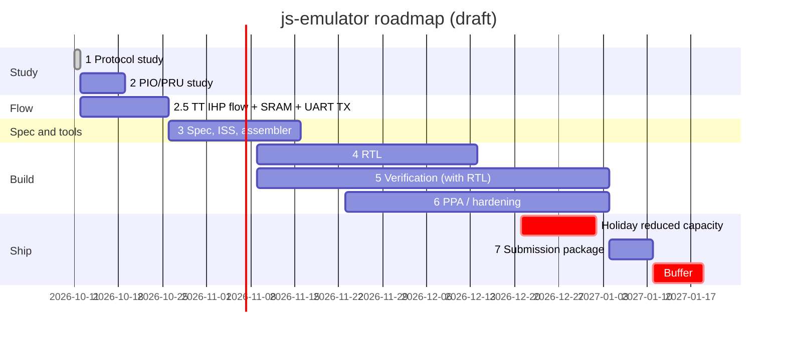

# Roadmap (preliminary)

> **Status: Draft — open for discussion.** Dates, milestones, exit criteria
> and protocol assignments are a working plan, not commitments. Comments and
> alternative proposals are welcome.

Written 2026-10-11. Calendar: 14 weeks from Sun 2026-10-11 to the submission
deadline **Mon 2027-01-18**. Reduced capacity assumed around 2026-11-26 (US
Thanksgiving) and 2026-12-21 → 2027-01-01 (holidays). Target submission
**Sun 2027-01-10**, leaving 8 days of buffer.

Architecture and verification plan: [architecture.md](architecture.md).
Protocol details: [protocols/](protocols/README.md).

## Phases

| # | Phase | Output |
|---|---|---|
| 1 | Protocol study | Per-protocol notes, comparison and requirement matrix, primitive set |
| 2 | Study of existing programmable IO blocks (RP2040/RP2350 PIO, TI PRU) | Ideas to borrow or change; revised ISA sketch |
| 2.5 | Tiny Tapeout IHP flow bring-up | Working flow (GitHub Action and local), first real area and Fmax numbers |
| 3 | Specification, reference model, toolchain v0 | ISA / pin / memory / host-link / reset spec, ISS, assembler |
| 4 | RTL | Parameterized RTL for the 6x4 (and 8x4) configurations |
| 5 | Verification (runs together with 4) | Co-simulation, formal, constrained-random, protocol oracles |
| 6 | PPA / hardening | Clean GDS, timing and area reports, TT precheck passing |
| 7 | Submission package | Repository, docs, examples, verification write-up |

## Timeline

## Milestones and exit criteria

| ID | Phase | Window | Exit criteria (all must hold) | Protocols |
|---|---|---|---|---|
| M1 | 1 Protocol study | done 2026-10-11 | Per-protocol notes, comparison + requirement matrix, primitive set, draft architecture, this roadmap | All studied |
| M2 | 2 PIO/PRU study | 2026-10-12 → 10-18 | Feature-by-feature map of PIO and PRU onto the requirement matrix; borrow/change list; ISA sketch revised | — |
| M2.5a | 2.5 Flow | 2026-10-12 → 10-18 | Latest TT GDS GitHub Action builds GDS + precheck for a 6x4 skeleton; [local hardening](https://tinytapeout.com/guides/local-hardening/) set up (tt-support-tools, `--ihp`, `PDK=ihp-sg13cmos5l` at the precheck's PDK commit); 6x4 die area recorded; 8x4 die area recorded if a template becomes available | — |
| M2.5b | 2.5 Probe | 2026-10-19 → 10-25 | Fixed UART TX hardened; then a 1-engine skeleton (SRAM IMEM per [ihp-sram-notes.md](ihp-sram-notes.md), next-PC loop, `out`/`jmp`/`wait`, bit clock) hardened with **slow-corner Fmax**, mapped cell area and IR-drop report over the macro; macro power checked in the GUI; operating clock chosen | UART TX (fixed, then programmable) |
| M3 | 3 Spec + model + toolchain v0 | 2026-10-26 → 11-15 | ISA / pin / memory / host-link / reset spec v1 (encodings frozen except reserved fields); single-source ISA description; **assembler + disassembler v0** emitting protocol packs; cycle-accurate ISS; UART (common bauds), SPI (modes 0–3), I2C (100/400 kHz) **controller and target** firmware pass in the ISS against independent models/sigrok decoders; area budget redone with measured numbers; 6x4 and 8x4 parameter sets fixed | **Core** on the ISS |
| M4a | 4 RTL | 2026-11-09 → 11-22 | One engine + SRAM + host SPI link in RTL; lockstep co-sim with the ISS green on directed and random programs; random-initial-state reset tests pass; hardens in the flow | UART on RTL |
| M4b | 4 RTL | 2026-11-23 → 12-06 | All engines (parameterized), pin modes (open-drain, pair), ownership, bit clock re-phase, line-code pipeline, CRC, FIFOs; core firmware passes on RTL including **concurrent** runs; **host library** on the RP2350 (MicroPython) loads packs and handles deselect → reselect → reload | Core on RTL, concurrent |
| M4c | 4 RTL, **feature freeze** | 2026-12-07 → 12-13 | Debug (halt/step/readback), sniffer/timestamps; no new RTL features after 2026-12-13 | JTAG, SWD, PS/2 firmware-only |
| M5 | 5 Verification | 2026-11-09 → 2027-01-03 (continuous) | Formal safety, reset and ISA conformance properties proven (or bounded to stated depth); constrained-random coverage goals met; mutation score recorded; gate-level sim with the SRAM model; extra-protocol examples done; stretch firmware verified | Extra protocols; USB LS device; CAN classic (sim); 10BASE-T TX if go |
| M6 | 6 PPA | nightly from 2026-11-23; closure 2026-12-14 → 2027-01-03 | 6x4 (or 8x4) GDS, 0 DRC/LVS errors, timing met at the chosen clock (slow corner), utilization with margin; TT precheck passes in the GitHub Action, or locally if the Action's 6-hour limit is hit | — |
| M7 | 7 Submission | 2027-01-04 → 01-10 | Submission package below complete; submitted | Demo set |
| — | Buffer | 2027-01-11 → 01-18 | Fixes only; submit by 2027-01-18 at the latest | — |

## Protocol landing plan

| Protocol | Tier | ISS (M3) | RTL sim | Demo |
|---|---|---|---|---|
| UART TX/RX, common baud rates | Core | ✓ | M4a | ✓ (also to the RP2350's USB serial) |
| SPI controller + peripheral, modes 0–3 | Core | ✓ | M4b | ✓ |
| I2C controller + target, 100/400 kHz | Core | ✓ | M4b | ✓ (pull-ups on a Pmod) |
| Concurrent mix (e.g. UART + SPI + I2C + sniffer) | Core | ✓ | M4b | ✓ |
| JTAG probe | Firmware-only | M4c | M4c | ✓ (IDCODE scan, pin discovery) |
| SWD probe | Firmware-only | M4c | M4c | ✓ (read DPIDR) |
| PS/2 host/device | Firmware-only | M4c | M4c | ✓ (level-shifter Pmod) |
| Extra protocols (below) | Firmware-only | M5 | M5 | ✓ |
| USB LS device | Stretch | M5 | M5 | Simulation; enumeration with host help if time |
| CAN classic ≤ 500 kb/s | Stretch | M5 | M5 | Simulation (transceiver Pmod for hardware) |
| 10BASE-T TX | Stretch, conditional on M2.5b (Fmax ≥ 40 MHz with margin) | M5 | M5 | Simulation (UDP frame, NLPs) |
| 10BASE-T RX, USB FS, CAN FD | Not planned | — | — | — |

**Extra protocols** (firmware only, written from the ISA document and the
assembler, no RTL change). Candidates: WS2812 addressable LEDs, Dallas
1-Wire, I2S audio out, RC servo PWM / DShot, RC-5 or NEC infrared, MDIO,
DMX512 (UART at 250 kbaud with break), SDLC/HDLC (bit stuffing after five
ones, CRC-16).

## Submission package

- [ ] Repository public with a license.
- [ ] RTL and tests.
- [ ] GDS from the Tiny Tapeout flow, passing the TT precheck.
- [ ] Architecture and ISA documentation.
- [ ] Assembler/toolchain with an example program per protocol, with Pmod
      wiring (pull-ups, transceivers, level shifters) documented.
- [ ] Verification write-up (methods, coverage, formal results, mutation
      score), including how AI tools were used.
- [ ] Optional demo video.

## Decision points

| When | Decision | Input |
|---|---|---|
| 2026-10-14 | Stretch protocol plan and architecture direction | Protocol study, draft architecture |
| If an 8x4 template becomes available | Adopt 8x4? Which configuration (6 engines + data SRAM, or 4 engines with bigger memories) | Empty 8x4 harden, area budget |
| 2026-10-25 (end M2.5b) | Operating clock; SRAM vs 64×16 macro vs latch IMEM; engine count; Ethernet TX go/no-go | Probe Fmax, area, IR drop |
| 2026-11-15 (end M3) | ISA encoding freeze; parameter sets fixed | ISS results, PIO/PRU study |
| 2026-12-13 | Feature freeze; cut list if area/timing at risk (order: Ethernet TX helpers, CRC-32 → CRC-16, FIFO depth, data SRAM, engines 6 → 4 → 3) | RTL and PPA status |
| 2027-01-03 | Go for submission with what is verified | Verification and PPA status |

## Open items

- HDL choice before M4a.
- Board details: crystal accuracy for the 40 MHz clock, DIP switch
  interaction with the host-link pins.
